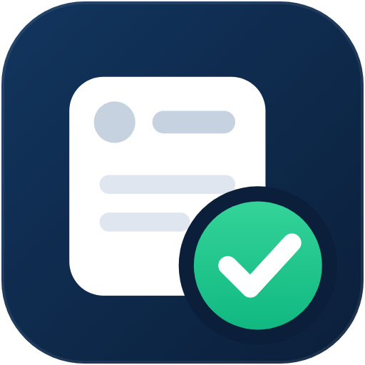
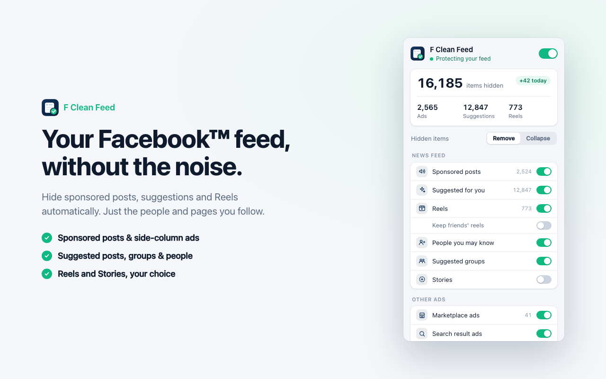

<p align="center">
  
</p>

<h1 align="center">F Clean Feed</h1>

<p align="center">
  Ad &amp; Reels blocker for Facebook: free, private, no account.<br>
  Chặn quảng cáo &amp; Reels cho Facebook: miễn phí, riêng tư, không cần tài khoản.
</p>

<p align="center">
  <a href="https://cleanfeed.viennv.dev/">Website</a> ·
  <a href="https://github.com/viennv96/f-clean-feed/releases/latest">Download</a> ·
  <a href="https://cleanfeed.viennv.dev/privacy-policy.html">Privacy</a>
</p>

<p align="center">
  <a href="https://github.com/viennv96/f-clean-feed/releases/latest"></a>
  <a href="https://github.com/viennv96/f-clean-feed/releases"></a>
</p>



## Tính năng

- **Bảng tin:** bài được tài trợ, "Gợi ý cho bạn", Reels (có tuỳ chọn giữ Reels của bạn bè), "Những người bạn có thể biết", nhóm gợi ý, thanh Tin (Stories).
- **Quảng cáo khác:** Marketplace, kết quả tìm kiếm, cột phải.
- **Giao diện:** nhắc sinh nhật, số đếm thông báo, chế độ gọn (ẩn 2 cột bên ở trang chủ).
- **Không tự tải lại bảng tin** (bật sẵn): Facebook thường nạp lại bảng tin và nhảy về đầu trang khi bạn quay lại tab sau hơn 2 phút ở app khác. Tuỳ chọn này giữ nguyên chỗ bạn đang đọc, và không cho Chrome (Memory Saver) tạm tắt tab Facebook khi chạy nền.
- **Xem bình luận ngay dưới bài** (bật sẵn): bấm *Bình luận* là bình luận hiện ngay dưới bài trên bảng tin, không mở hộp thoại. Bấm lần nữa để ẩn; *Viết bình luận* và *Xem tất cả* vẫn mở hộp thoại của Facebook.
- Popup tiếng Việt và tiếng Anh: mặc định theo ngôn ngữ của Chrome, đổi bằng công tắc **VI / EN** ở đầu popup.
- Hai chế độ: xoá khỏi trang, hoặc thu gọn (bấm để xem lại). Thống kê theo ngày và tổng.
- Quảng cáo bị ẩn trước khi trình duyệt kịp vẽ, nên không có hiện tượng "nháy" quảng cáo.
- Không máy chủ, không analytics, không mã bên thứ ba. Chỉ cần quyền `storage` và `alarms`, chỉ chạy trên facebook.com.
- **Nhắc cập nhật** (bản cài từ GitHub): mỗi 6 giờ kiểm tra bản phát hành mới nhất trên GitHub; có bản mới thì biểu tượng hiện nhãn **NEW** và popup có hướng dẫn 3 bước: tải zip, giải nén chép đè, bấm *Cập nhật ngay* (extension tự tải lại, không cần vào `chrome://extensions`). Bấm số phiên bản ở cuối popup để kiểm tra ngay.
- Một thẻ quảng cáo nhỏ cho **MMO VPS** ([viennv.dev](https://viennv.dev), dịch vụ VPS của tác giả) ở cột phải trang chủ, đúng chỗ khối "Được tài trợ" của Facebook vừa bị ẩn. Thẻ có nhãn "Quảng cáo", hiển thị theo ngôn ngữ của Facebook, không tải gì từ mạng (logo được đóng gói sẵn). Bấm × để ẩn 7 ngày, hoặc tắt hẳn ở mục *Thẻ giới thiệu của tác giả* trong popup.

## Cài đặt

**Chrome Web Store:** đang chờ duyệt.

**Cài thủ công:**

1. Tải `f-clean-feed-<version>.zip` ở trang [Releases](https://github.com/viennv96/f-clean-feed/releases/latest) và giải nén.
2. Mở `chrome://extensions`, bật **Developer mode**.
3. Bấm **Load unpacked** và chọn thư mục vừa giải nén (thư mục chứa `manifest.json`).
4. Tải lại facebook.com.

## Cách hoạt động

| File | Vai trò |
|---|---|
| `background.js` | Service worker: giữ tab Facebook không bị Memory Saver tắt khi bật "Không tự tải lại bảng tin", và kiểm tra bản mới trên GitHub (API công khai, mỗi 6 giờ) cho bản cài thủ công. |
| `content/main.js` | Chạy trong MAIN world. Tìm từng bài trong `[role=main] div[data-virtualized]` (bố cục hiện tại) hoặc `[role=feed] > div` (bố cục cũ), ngay trong callback của MutationObserver, tức là trước khi trang được vẽ. Nhận diện quảng cáo bằng cách lần theo chuỗi SVG `<use>` vẽ nhãn "Được tài trợ"/"Sponsored"; dự phòng bằng React fiber, `aria-labelledby`, link `/ads/about`, tiêu đề đa ngôn ngữ, link `/friends/suggestions`, `/groups/discover`, `/reel/`. Chỉ gắn `data-fbc-kind`, không xoá node. |
| `content/comments.js` | MAIN world: khi bấm *Bình luận*, đọc bình luận từ chính truy vấn mà hộp thoại bài viết của Facebook gửi đi, đóng hộp thoại (được giấu trong lúc tải) và vẽ bình luận ngay dưới bài. Lỗi bất kỳ thì hộp thoại hiện như bình thường. |
| `content/bridge.js` | Isolated world: đọc cài đặt từ `chrome.storage.sync`, ghi danh sách loại cần ẩn lên `<html data-fbc-hide="…">`, gom thống kê rồi ghi mỗi 2 giây, và đặt thẻ MMO VPS vào cột phải. |
| `content/hide.css` | Quyết định ẩn bằng CSS thuần, nên bật/tắt có hiệu lực ngay, không phải quét lại. |
| `popup/` | Popup HTML/JS thuần, không dùng framework. |
| `docs/` | Website (GitHub Pages) và chính sách quyền riêng tư. |
| `store/` | Ảnh, mô tả và checklist cho Chrome Web Store. |

## Phát triển

- `test/fixture.html`: bảng tin giả, mô phỏng cả bố cục cũ và mới của Facebook.
- `test/popup.html`: hiển thị popup với `chrome.*` giả lập (`?lang=en` cho tiếng Anh).
- `test/promo.html`: cột phải giả để thử thẻ MMO VPS (vị trí, nút ×, công tắc trong popup).

Phục vụ thư mục này qua một static server bất kỳ ở cổng 8765, mở `/test/fixture.html` rồi chờ khoảng 6 giây. Gọi `window.__fbcDebug(el)` để xem một bài được phân loại thế nào; trên Facebook thật cũng gọi được hàm này trong DevTools.

Build ảnh store, gói zip và cập nhật ảnh cho website (cần server ở cổng 8765):

```bash
sh store/build.sh
```

## Lịch sử phiên bản

**1.4.1**
- Sửa "Xem bình luận ngay dưới bài": hộp thoại bài viết đôi khi vẫn hiện lên sau khi tải xong (thường ở bài chưa có bình luận trong nhóm), và có lúc trang bị lùi về trang trước. Giờ hộp thoại luôn được đóng bằng chính Facebook, thử lại đến khi đóng hẳn.

**1.4.0**
- Nhắc cập nhật cho bản cài từ GitHub: kiểm tra bản mới mỗi 6 giờ, biểu tượng hiện nhãn NEW, popup hướng dẫn 3 bước (tải zip, chép đè, *Cập nhật ngay* để extension tự tải lại). Bấm số phiên bản ở cuối popup để kiểm tra ngay.
- Thêm quyền `alarms` (hẹn giờ kiểm tra). Yêu cầu mạng duy nhất là hỏi GitHub API số phiên bản mới nhất, không gửi dữ liệu nào của bạn.

**1.3.1**
- Thẻ MMO VPS ở cột phải có lề 16px: thẳng hàng với avatar trên thanh đầu trang và các khối của cột phải, không còn sát thanh cuộn.
- Website: số lượt tải không còn hiện phiên bản cũ sau khi phát hành bản mới.

**1.3.0**
- Tuỳ chọn mới "Xem bình luận ngay dưới bài" (bật sẵn): bấm *Bình luận* là bình luận hiện ngay dưới bài trên bảng tin, có ảnh/nhãn dán và hiệu ứng đang tải, không mở hộp thoại. *Viết bình luận*, *Xem tất cả* và *N phản hồi* vẫn mở hộp thoại của Facebook.
- Popup có tiếng Việt và tiếng Anh, đổi bằng công tắc VI / EN (mặc định theo ngôn ngữ của Chrome).

**1.2.0**
- Tuỳ chọn mới "Không tự tải lại bảng tin" (bật sẵn): Facebook không còn nạp lại bảng tin và nhảy về đầu trang khi bạn quay lại tab sau vài phút ở app khác.
- Tab Facebook không bị Chrome (Memory Saver) tạm tắt khi chạy nền trong lúc bật tuỳ chọn này.

**1.1.1**
- Tên extension không còn ký hiệu ™ ("… cho Facebook").
- Thẻ quảng cáo MMO VPS hiển thị theo ngôn ngữ của Facebook (tiếng Việt hoặc tiếng Anh).

**1.1.0**
- Thẻ quảng cáo MMO VPS (viennv.dev) ở cột phải trang chủ, có logo, nút × ẩn 7 ngày và công tắc tắt trong popup.
- Logo MMO VPS trong popup và website.

**1.0.0**
- Phát hành đầu tiên: chặn bài tài trợ, gợi ý, Reels, Tin, PYMK, nhóm gợi ý, quảng cáo Marketplace/tìm kiếm/cột phải; chế độ gọn; thống kê.

## Tác giả

[Nguyễn Văn Viên](https://viennv.dev).

<a href="https://viennv.dev"> <b>MMO VPS</b></a>: máy chủ ảo, máy chủ livestream và proxy tĩnh, nhận máy trong vài phút tại [viennv.dev](https://viennv.dev).

---

Facebook is a trademark of Meta Platforms, Inc. F Clean Feed is an independent project and is not affiliated with, endorsed or sponsored by Meta.
